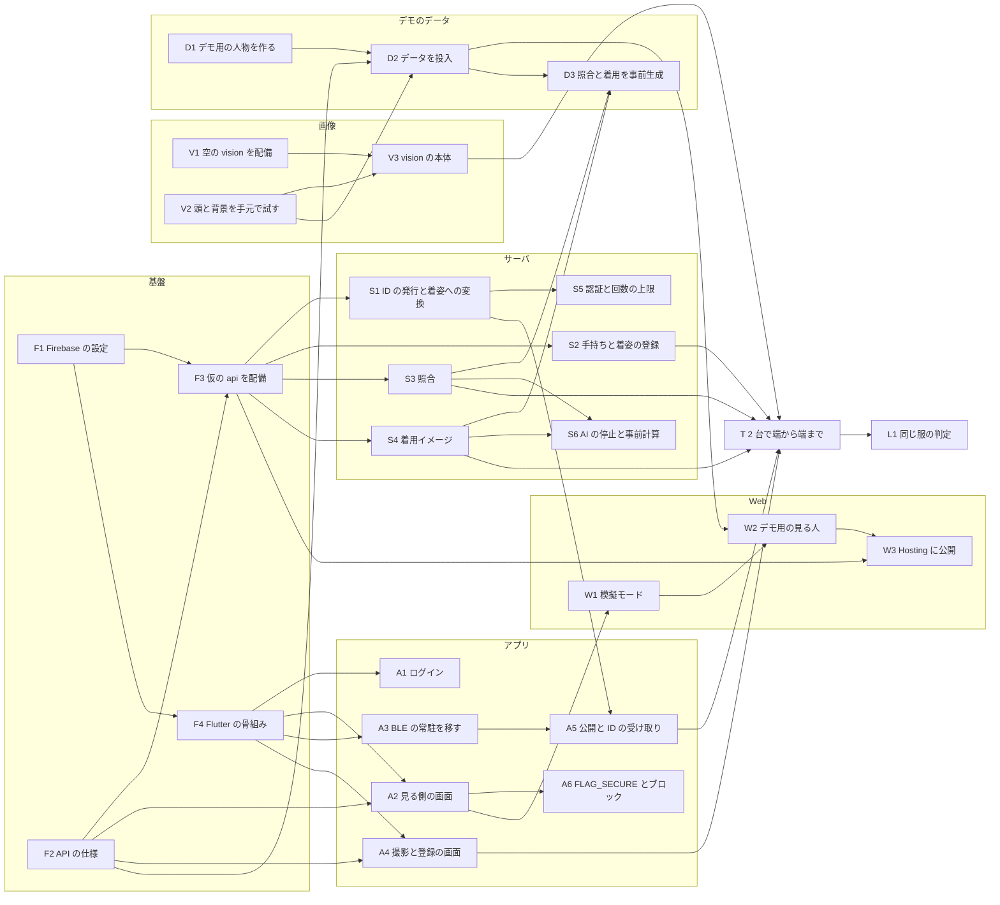

# 作業の順番と依存

下の「主な担当の目安」を基本にしつつ、手が空いた人は担当の外でも「前提がそろった物」から取ってよい。取る時は、この表の「取った人」に名前を書いて push する (2 人が同じ物を始めないため)。設計は `docs/architecture.md`、決めた理由は `docs/tech-decisions.md`。

## 主な担当の目安

| 人 | 主に持つ物 | ID |
|---|---|---|
| 田中 | アプリの土台と Android にしか無い部分 (骨組み・ログイン・BLE の常駐・撮影と登録・公開) | F4、A1、A3、A4、A5、A6、L3 |
| 青山 | 見る側の画面 (Android と Web で共通)、Web デモ、デモ用の人物 | A2、W1、W2、W3、D1 |
| 白井 | サーバとクラウド (Firebase・`api`・`vision`・配備・Gemini)、デモのデータの投入 | F1、F2、F3、S1〜S6、V1〜V3、D2、D3、L1、L2 |

提出物 (説明ドキュメント・スライド・動画・著作物利用シート) の担当はまだ決めない。

状態 (2026-11-08 朝): 製品のコードはまだ無い。決まっているのは設計と、BLE の検証用アプリ (`poc/ble/`)、画像の処理の試験 (手元)。

## 締め

| いつ | 何 |
|---|---|
| 11/9 昼 | デプロイ URL を確保する (W3 が公開されている) |
| 11/9 18:00 | 機能の追加を止める。同じ服の判定 (L1) もここで打ち切る |
| 11/10 15:00 | 最後の配備 |
| 11/10 17:00 | 提出用リポジトリへ push (昼に一度試す) |
| 11/10 19:00 | 提出締切 |

## 依存の図

## 一覧

「前提」が全部そろったら取れる。大きさは AI に書かせる前提の目安 (小: 1 時間前後、中: 2〜3 時間、大: 半日)。

### 前提なしで今すぐ取れる物

| ID | 何をする | 大きさ | 前提 | 取った人 |
|---|---|---|---|---|
| F1 | Firebase をプロジェクトに足す: Authentication (Google と匿名)、Firestore (`asia-northeast1`)、Storage、Hosting。アプリを Android と Web で登録し、全員の debug の SHA-1 を入れる | 小 | プロジェクトのオーナー | 白井 (済。Android と Web のアプリを登録し、firebase_options.dart を置いた。debug の SHA-1 は 3 人とも登録済み) |
| F2 | API の仕様 (OpenAPI) とデータの形 (カード・服・照合の結果・jobs) を決めて `docs/api.yaml` に置く。`architecture.md` の 3〜4 節が元 | 中 | — | 白井 (済、`docs/api.yaml` と `docs/api-examples/`) |
| V1 | 空の `vision` (SAM と isnet の重みを読み込むだけ) を Cloud Run に配備する。数 GB のイメージのビルドが通るかを先に確かめる | 中 | — | 白井 (配備済み) |
| V2 | 頭を塗る (上の帯 + YuNet の顔の枠)・塗った後の顔の確かめ・isnet の 2 値化と一番大きい塊を手元で作り、Commons の 5 枚で試す。頭と背景を消した画像で Gemini と SAM が今まで通り動くかも見る | 中 | — | 白井 (済) |
| D1 | デモ用の人物を作る: 見られる側 2〜3 人 (着姿)、見る人 1 人 (全身写真と手持ち 5〜10 着)。AI で作った架空の人物にし、「AI 生成」と明示する | 中 | デモの筋書き (誰が何を見るか) | 青山 (済、`docs/mockups/ai-generated-people/`。デモは 1・3・6 番を見られる側、2・8・10 番の服を見る人の手持ちに使った) |
| — | カテゴリを決める | — | — | |

### 基盤がそろった後

| ID | 何をする | 大きさ | 前提 | 取った人 |
|---|---|---|---|---|
| F3 | 仮の `api` (AI を呼ばず決まった値を返す) を Cloud Run に配備し、`deploy.sh` を作る | 小 | F1、F2 | 白井 (済。11/9 に役目を終え、普段の URL は本物に切り替えた) |
| F4 | Flutter の骨組み (`app/`): `flutterfire configure`、画面の行き来、`api` を呼ぶ部品 | 小 | F1 | 田中 (済。骨組み・api を呼ぶ部品・Firebase のログイン (Android は Google、Web は匿名)) |
| A1 | ログイン: Android は Google、Web は匿名 | 小 | F4 | 青山（画面） |
| A8 | マイページ画面をモックに合わせる | 小 | F4 | 青山（画面） |
| A7 | ホーム画面の余白、通知ボタンと通知一覧 | 小 | F4 | 青山（画面） |
| A2 | 見る側の画面: 近くの人の一覧 → 着姿 → 服を選ぶ → 照合の結果 → 着用イメージ。Android と Web で同じコード。仮の `api` か、仕様どおりの JSON で先に作れる | 大 | F2、F4 | 青山（近くのコーデ・詳細） |
| A3 | BLE の常駐を `poc/ble/` から `app/android/` に移し、MethodChannel / EventChannel でつなぐ。発信は ID 11 バイト + 強さ 1 バイト、受信は直近 5 分 | 大 | F4 | 田中 (実装済み。実機 2 台での確かめは T で白井) |
| A4 | 撮影と登録の画面: アプリのカメラで撮る → `vision` に送る → `jobs` を購読 → 結果を確かめて登録 | 中 | F2、F4 | 青山（撮影・写真確認画面）、田中 (済: vision に送る・jobs を待つ・登録へのつなぎ。エミュレータで本物の vision を通した) |
| S1 | 匿名 ID の発行 (公開時にその日の 288 個) と、ID → 今日の着姿 (1 日 1 回は HMAC、お互いさま、`DEMO_UIDS` の例外、使い捨てのカード ID) | 中 | F3 | 白井 (済。普段の URL https://api-591807217114.asia-northeast1.run.app が本物) |
| S2 | 手持ちと今日の着姿の登録 (`jobs` の結果から) | 小 | F3 | 白井 (済、本物の api に配備) |
| S3 | 照合: `gemini-3.8-flash` に見た服と手持ちを見せ、組み合わせ・理由・足りない 1 着を返させる | 中 | F3 | 白井 (済、本物の api に配備。似た服をもう持っているかも返す) |
| S4 | 着用イメージ: `gemini-nano-banana-2.1`。自分の写真を Storage に置き、本人にだけ返す | 中 | F3 | 白井 (済、本物の api に配備。Web の審査員は自分の写真でも試せる) |
| V3 | `vision` の本体: V2 の処理 + Gemini の枠と点 + SAM 2.1。結果を Storage と `jobs` に書く | 大 | V1、V2 | 白井 (配備済み。1 枚 18〜23 秒、0 台からの起動は 26〜35 秒) |

### 組み合わせる段

| ID | 何をする | 大きさ | 前提 | 取った人 |
|---|---|---|---|---|
| A5 | 公開の切り替え: S1 から ID を受け取り、常駐サービスに渡して発信を始める。24 時に切る | 中 | A3、S1 | 田中 (実装済み。公開すると ID を受け取って常駐が発信する。実機での確かめは T で白井) |
| A6 | 着姿の画面の FLAG_SECURE、ブロックと通報の最小の画面 | 小 | A2 | 青山 (A2 の中で実装済み。田中の部品版は重なるので捨てた) |
| S5 | `api` と `vision` の両方で ID トークンの検証と、利用者ごとの回数の上限 | 小 | S1 | 白井 (済) |
| W1 | Web の模擬モード: 近くの人の検出を模擬し、画面に「模擬」と書く | 小 | A2 | 田中・青山 (済。Web は匿名で入り、模擬の検出と「模擬」の帯を出す) |
| W2 | Web のデモ用の見る人: 匿名の審査員は D1 の見る人として動く | 小 | W1、D2 | 白井 (済。匿名の審査員は demo-viewer として動く) |
| W3 | Firebase Hosting に公開し、デプロイ URL を README に書く (**11/9 昼まで**) | 小 | W2、F3 | 田中 (済。11/9 に最新の main で出し直した。最後の出し直しは 11/10 15:00 まで) |
| D2 | デモのデータの投入: 手元で V2 と同じ処理を流し、Firestore と Storage に直接入れるスクリプト (`scripts/`) | 中 | D1、V2、F2 | 白井 (済。`scripts/seed_demo.py` で demo-haru・demo-ken・demo-mio と demo-viewer を入れた) |
| D3 | デモの照合と着用イメージを事前に生成して保存する | 小 | D2、S3、S4 | 白井 (済。照合 13 件・着用イメージ 31 枚) |
| S6 | AI を止める環境変数と、止まった時に事前計算の結果を返す切り替え | 小 | S3、S4 | 白井 (済、本物の api に配備) |
| T | 2 台で端から端まで: 撮影と登録 → 公開 → すれ違い → 見る → 照合 → 着用イメージ。本物の BLE の場面をここで撮る | 中 | A4、A5、S2、S3、S4、V3 | 白井 (11/8 夜、Note10+ と S25 Ultra の 2 台で試し中) |

### 余裕があれば (11/9 18:00 で打ち切る)

| ID | 何をする | 大きさ | 前提 | 取った人 |
|---|---|---|---|---|
| L1 | 同じ服の判定 (`gemini-embedding-2` + Firestore の `find_nearest` + 本人の 1 タップ) | 中 | T | 白井 (サーバは済み: GET /v1/jobs/{jobId}/same-items と PUT の sameAs。画面 (S9 の「これでは?」) は未) |
| L2 | Cloud Build のトリガー (タグの push で `deploy.sh`) | 小 | F3 | |
| L3 | BLE の残りの実測 (見る側の画面オフ、距離、開くまでの秒数) | 小 | A3 | |
| L4 | Android の審査員向けの APK: Web デモの入口に「Android の方はアプリも試せます」と添えて落とせるようにする。アプリでも W1 の模擬の検出に切り替えられるようにする。リリースの署名、Google ログインのための署名の指紋を Firebase に登録、置き場所 (Firebase Hosting など)。Web が主役で、これは W3 の後の空き時間で (配る作業なので 11/10 19:00 の提出まで) | 小 | W1、W3 | 白井 (済、11/9 夜。Hosting の `/wear-by.apk`、PC では外枠の QR、狭い画面では帯の link。Note10+ で起動とログインの更新を確認。外枠は `app/lib/app/web_stage.dart`、runbook の 8 節) |
| L5 | フレンドの一覧・検索と、申請の確認・整理の画面 | 小 | F4 | 青山（画面） |

### 11/8 夜の見直し (2 台で通した後にチームと各 AI から挙がった物)

決まり: 「名前、プロフィール、過去の投稿は出さない」「連絡、フォロー、過去の投稿への移動は作らない」「着姿は持ち帰れず、保存できるのは服の情報だけ」(`docs/concept.md` の 6 節) とぶつかる物は、作るかをチームで決める。

| ID | 何をする | 大きさ | 前提 | 取った人 |
|---|---|---|---|---|
| M1 | 顔を隠す形を変える (2026-11-09 白井): 顔が見つかった時は顔 (目から顎まで) だけを強くぼかして髪は残す。隠した後に顔と見えればぼかしを強め、最後は塗る。顔が見つからない時は頭の形に沿って塗る | 小 | V3 | 白井 (済、本番に配備) |
| M2 | カードの画像の透かしを外す (漏れた画像を辿る手順は無く、画面の保存は Android で止めている) | 小 | S1 | 白井 (済、配備済み) |
| M3 | 投稿の再送で服が重複しない: 同じ jobId の 2 回目は前の結果を返す | 小 | S2 | 白井 (済、配備済み) |
| M4 | 過去のコーデを投稿時点で残す: 登録の時に `dailyOutfits` に `outfitImage` と `snapshot` (服の名前・属性・メモ・画像の口) を写す。カレンダーはこれを読み、月ごとに日付で絞って取る | 小 | S2 | 白井 (サーバは済み、配備済み)、アプリの読み方は M14 |
| M5 | 投稿後の編集: 青山の契約 (`PUT /v1/outfits/today` に `editDate`、服は検出した服・手持ち・メモだけの 3 つの形) のとおり、登録済みの今日のコーデの服を外す・手持ちやメモを足す・コーデ専用のメモを直す。検出されなかった服の切り抜きは入れない | 小 | S2 | 白井 (サーバは済み、配備済み)、画面は青山 |
| M6 | 実機が無くても試せる: Android でも開発用の切り替えで模擬の検出 (`POST /v1/demo/nearby`) を使う。サーバは Google でログインした人にも開いた (返るのは架空の人物だけ) | 小 | W1 | 白井 (サーバは済み、配備済み)、アプリは M15 |
| M7 | 青山のデザインが反映されていない UI の直し、UI のズレの直し、フローの洗い出しと不適切なフローの除去 | 中 | — | 青山、田中 (作業中) |
| M8 | フレンド (2026-11-09 白井: 作る): 実際の友人どうしがフレンドコードか QR で申請し、相互に承認。一覧・解除・その日の公開コーデ・プロフィール画像。すれ違いのカードからは追加できない。口は `docs/api.yaml` の friends | 大 | — | 白井 (サーバは済み、配備済み)、画面のつなぎは M11 |
| M9 | いいね (フレンドの今日の公開コーデと、近くのコーデのカード。カードの相手には誰からかを出さない) と保存 (服の情報だけ、画像は持ち帰らない) | 中 | M8 | 白井 (サーバは済み、配備済み)、画面は M12 |
| M10 | 通知: サーバに置いて既読を同期、端末の FCM トークンの登録、アプリを閉じていても届くプッシュ (申請・承認・いいね・処理の完了) | 中 | M8 | 白井 (サーバは済み、配備済み。vision も処理の完了を通知する)、画面は M13 |

#### 画面の側 (UI の直しが終わって手が空いた人から取る。口は `docs/api.yaml`)

| ID | 何をする | 大きさ | 前提 | 取った人 |
|---|---|---|---|---|
| M11 | フレンドの画面を本物につなぐ: 自分のフレンドコードと QR を出す (`/v1/me` の `friendCode`)、コードか QR の読み取りで申請 (`POST /v1/friends/requests`)、届いた申請の承認・辞退、一覧と解除、フレンドの今日の公開コーデ (`GET /v1/friends`)、プロフィール画像の置き方と表示 (`PUT /v1/me/profile-image`)。「名前で検索」はフレンドの中からの絞り込みのまま。開発用の架空のデータ (`SOCIAL_PREVIEW`) は外してよい | 中 | M8 | 青山 (実装済み。Pixel 7 エミュレーター 2 台で公開コーデとプロフィール画像を確認。QR 申請・承認は利用者が確認済み) |
| M12 | いいねと保存の画面: フレンドの投稿と近くのコーデのカードにいいね (`PUT/DELETE /v1/likes/...`)、服の保存 (`POST /v1/saves`) と保存の一覧。保存の一覧には画像を出さない (服の情報だけ) | 小 | M9 | 青山 (Pixel 7 エミュレーター 2 台でフレンドへのいいね・服の保存・保存一覧を確認。Android の模擬カードでも本番 API でいいね・保存・保存解除を確認) |
| M13 | 通知を本物につなぐ: 一覧と未読 (`GET /v1/notifications`)、既読 (`POST /v1/notifications/read`)。プッシュは `firebase_messaging` を入れ、Android の通知の許可を取り、FCM トークンを `PUT /v1/me/devices` に送る。通知を押したら種類で開く画面を分ける | 中 | M10 | 青山 (2 台でアプリ内通知・既読化を確認。いいねからホーム、処理完了から結果画面へ遷移。Android の既定 Firebase 設定をビルド時に生成するよう修正し、両端末でネイティブ初期化と FCM 登録の成功を確認。修正版でアプリ終了中に新しいコーデ処理を完了させると、両端末ともアプリ内通知から結果を開けたが、端末プッシュは届かず。修正版で近接いいねも 5556 から終了中の 5554 へ送信し、端末プッシュは届かず、再起動後のアプリ内通知からホームへの遷移を確認。逆方向は当日の近接カードを再取得できず未試験。端末プッシュからの遷移と本番からの FCM 送信結果は未確認) |
| M14 | カレンダーを投稿時点の写しで出す: `dailyOutfits` の `outfitImage`・`snapshot`・`itemNotes` を読む (手持ちを見に行かない)。月ごとに日付で絞って読む | 小 | M4 | 田中 (済。エミュレータで本物の Firestore に投稿して確認) |
| M15 | 実機で BLE の代わりに模擬の検出を使う開発用の切り替え (例 `--dart-define=MOCK_NEARBY=true` で `api.demoNearby()`)。サーバは Google でログインした人にも開いてある | 小 | M6 | 青山 (実装済み。Pixel 7 エミュレーターの Google ログインで本番 API の模擬カードを表示し、いいね・保存を確認) |
| M16 | フレンドの今日の公開コーデから服を選び、近くのコーデと同じ照合・着用イメージへ進む | 中 | M8、S3、S4 | 青山 (画面・API 実装済み、テスト済み。本番 API の配備と実アカウントでの通し確認は未) |
| M17 | 撮影画面で前面・背面カメラを切り替える | 小 | A4 | 青山 (実装済み。Android エミュレーターで両方向の切り替えと撮影、撮りなおしとアプリ復帰時のカメラ維持を確認) |

#### M16 の引き継ぎ (2026-11-10)

- 実装済み: ホームのフレンド投稿とフレンドのプロフィールで服の詳細を開くと、近接共有と同じ着姿・アイテム選択・「手持ちと照合」の画面を使う。いいねとアイテムの保存はフレンド側の操作につなぎ、Android では詳細の表示中に画面保存を防ぐ。照合結果と「着てみる」も近接共有と同じ画面と `POST /v1/match`・`POST /v1/tryon` を使う。メモだけの項目は照合できない。
- `server/api/` に追加済み: `POST /v1/friends/{friendId}/today/items/{index}/card` が、選択した服の照合用カードを返す。API の形とエラーは `docs/api.yaml` が正本。フレンド関係と今日の公開状態を確認し、解除・非公開・日付変更・服の変更時にはカードを無効にする。照合に使う手持ちは見る人本人の物に限り、uid や相手の服の id は返さない。
- **残り: 白井さんがチームの了承を取って `api` を配備する。** 手順は `docs/runbook.md` の 1〜2 節。変更を含む `main` から `server/api` をビルドし、既存の環境変数と通信先を維持して配備する。`vision` に変更はない。配備前の本番 API には新しいカードの口がないため、更新したアプリでもフレンドからの照合は使えない。
- 配備後に確認: 実際のフレンド 2 アカウントで、相手の今日の公開コーデ → 服を選択 → 「手持ちと照合」→「着てみる」を通す。フレンド解除・非公開後は使えないことも確かめる。配布用 APK を更新する場合は、この変更を含めてビルドし、Hosting の APK も差し替える。
- 確認済み: Flutter テスト 113 件、Firestore エミュレーターを使ったフレンド・カード・照合・着用イメージのサーバーテスト 97 件。画面の配置は Android エミュレーターで AI 生成の架空データを使って確認した。実アカウントと本番 AI を使った通し確認はまだ行っていない。

## 一番長い道

`F1 → F4 → A3 → A5 → T` (アプリの BLE) と、`V1 / V2 → V3 → T` (画像) の 2 本が長い。ここを止めないよう、F1・V1・V2 は最初に手を付ける。デプロイ URL (W3) は T を待たずに出せるので、BLE が遅れても審査員が触る物は先にそろう。
